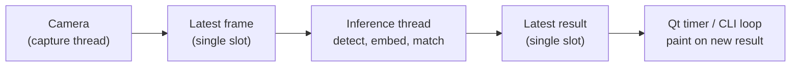

# Local Face Recognition

> **Learning project.** This repository exists for study and demonstration. It is not a
> real deployment, not a product, and not certified for any security or attendance
> purpose. Do not use it as the only control for access, payroll, or disciplinary
> decisions.

Face recognition and daily attendance that run entirely on your own machine. You
record each person's face once, the camera keeps watching, and a confirmed match marks
that person present for the day. Nothing leaves the computer: no cloud service, no API
key, no network call after the model has been downloaded.

Built for an ordinary laptop without a discrete GPU, and the same code runs on a
single-board computer such as a Raspberry Pi or an Orange Pi.

What it does:

- **Recognises registered faces** from a live camera, with a similarity percentage per
  frame and a name that only appears after several agreeing frames.
- **Tells a real face from a photo or a screen.** A geometric check compares nose
  parallax against the flat plane of the eyes and mouth, and labels the result. It is a
  measurement, not a certificate (see §5.7).
- **Records daily attendance.** Once per person per day, guaranteed by the database.
  Present versus late, a CSV export, and a delete action for corrections.
- **Encrypts what identifies a person.** Names and embeddings are AES-GCM encrypted at
  rest under a key you hold (§5.8).
- **Manages people properly.** Rename, deactivate (stops matching, keeps history), or
  delete, with a local audit trail of every change.
- **Adapts to weak hardware.** Four performance tiers, chosen from the CPU and RAM,
  down to a 1 GB single-board computer.
- **Runs headless.** The CLI works without Qt or a display, which is what a board
  mounted next to a door needs.

---

## 1. Requirements

| Item | Minimum | Notes |
| --- | --- | --- |
| Python | 3.11 | Wheels for the pinned dependencies exist for 3.10 to 3.14; 3.11+ is tested |
| Disk | about 1.2 GB | 330 MB model, dependency wheels, room for the database |
| RAM | 1 GB | Below that, use the `minimal` tier and expect single-digit inference FPS |
| Camera | one USB or built-in webcam | 640x480 is enough; higher resolution costs CPU |
| OS | Windows 10+, Linux (x86_64, aarch64, armv7), macOS | No GPU required |
| Network | only during install | The model is downloaded once; the app then works offline |

Optional: `PySide6` for the desktop window. Without it the CLI still works.

---

## 2. Install

### 2.1 One command

```bash
python install.py
```

On Linux or a single-board computer use `python3 install.py`. The script does, in
order, and stops at the first real failure:

1. checks the Python version;
2. creates a virtual environment in `.venv`;
3. upgrades pip inside it and installs `requirements.txt`;
4. creates `database/` and a `settings.json` skeleton;
5. creates the database key, `database/face_key.bin`, protected by
   `FACEID_PASSPHRASE` if that variable is set;
6. downloads the InsightFace `buffalo_s` pack into `models/buffalo_s/` with a progress
   bar, resuming if an earlier attempt was interrupted;
7. runs `python main.py status` as a self-check and prints the next steps.

It is safe to re-run: every step that is already done is skipped. It only installs into
its own `.venv` and only writes inside the project folder, apart from pip's own
download cache.

### 2.2 Manual install

If you prefer to do it yourself, or the script cannot run:

```bash
python -m venv .venv
# Windows
.venv\Scripts\activate
# Linux / macOS
source .venv/bin/activate

pip install -r requirements.txt
python main.py status        # checks imports, the database, and the camera list
```

Then create the key on first use: the app does that automatically the first time it
opens the database, so `python install.py` only does it earlier and more visibly. The
model is downloaded the first time the detector is used (`register`, `recognize`, or
`benchmark`), not by `status`.

### 2.3 Raspberry Pi and other boards

- 64-bit OS (aarch64) is the easy path: `onnxruntime`, `cryptography` and
  `PySide6-Essentials` all publish wheels for it.
- 32-bit armv7 is less well served. `onnxruntime` and `cryptography` may have to come
  from your distribution's packages (which can be older than the pins in
  `requirements.txt`), and `PySide6-Essentials` publishes no armv7 wheel at all, so the
  CLI is the practical interface there. If pip starts compiling Rust sources, that is
  the sign to use the system packages instead.
- `python install.py` is the same command. If the Qt wheel is missing, the installer
  still succeeds; only `main.py` without a subcommand will refuse to start, and the CLI
  commands keep working.
- The tier is chosen automatically from the core count and RAM. On a 2 GB board expect
  `low`, on a 1 GB board `minimal`. You can pin it with `performance.profile`.
- A cooling fan matters: sustained inference on a Pi throttles without airflow.

### 2.4 Verify the install

```bash
python main.py status
```

You should see the Python version, the hardware, the active performance tier, the
database path, `Storage  encrypted (AES-GCM)`, `Attendance enabled, start 08:00 ...`,
and the camera indices that could be opened. If the camera list is empty, see §12.

### 2.5 Where files live

| Path | What it is | In git? |
| --- | --- | --- |
| `config.yaml` | Baseline settings, with comments | yes |
| `settings.json` | What you changed on the Settings page | no |
| `database/face_database.db` | Identities, embeddings, attendance, audit log | no |
| `database/face_key.bin` | The key that decrypts names and embeddings | no |
| `database/backups/` | Copies written by `main.py backup` | no |
| `attendance/` | CSV exports | no |
| `models/buffalo_s/` | The downloaded model pack | no |
| `benchmarks/` | JSON performance reports | no |
| `.venv/` | The virtual environment | no |

---

## 3. Using it

### 3.1 The desktop app

`python main.py` opens the window. The sidebar has six pages:

| Page | What you do there |
| --- | --- |
| **Overview** | Registered identities, who is present today, camera setting, active tier, storage mode. Shortcuts to the other pages |
| **Recognition** | Start the camera, watch the live match, the similarity percentage, the presentation verdict, and whether attendance was recorded |
| **Record a face** | Enrol one person in five guided poses |
| **Attendance** | Any day's presence list, CSV export, delete a row |
| **Identities** | Rename, deactivate, reactivate, delete |
| **Settings** | Every adjustable value, grouped, with the ones that need a restart marked |

The window can stay open all day: the camera keeps running while you are on another
page, and attendance is recorded as people walk past.

### 3.2 Recording a new employee

1. Open **Record a face**. The next free ID is filled in for you; type the full name.
2. Press **Prepare camera** (loads the model and opens the camera; this can take a few
   seconds the first time).
3. Press **Start capture** and follow the five poses on screen: front, turn left, turn
   right, tilt, closer.
4. Each pose is only accepted when the frame matches it and passes the quality gate.
   The prompt tells you exactly what to fix ("turn further to the left", "move closer",
   "too dark").
5. When all five are captured, press **Save identity**.

**The name is required, not optional.** It is what the attendance list shows, so the
**Start capture** and **Save identity** buttons stay disabled until a name is typed, and
the field explains why in red. Nothing is written to the database until Save, and
leaving the page with a finished capture asks whether to discard it instead of throwing
the five samples away silently. A face cannot end up in the database without the person
it belongs to.

A photo or a screen showing a face is refused during enrollment, because a spoofed
sample would stay in the database for as long as that person exists.

From the terminal the same thing is one command, with the pose prompts in a preview
window:

```bash
python main.py register --id 004 --name "Dewi Lestari"
```

### 3.3 Daily operation

Leave the Recognition page running, or run it headless on a board:

```bash
python main.py recognize
```

- A name appears after the same identity wins `recognition.confirmation_hits` frames
  in a row, so one doubtful frame cannot clock somebody in.
- The first confirmed sighting of the day creates the attendance row. Later sightings
  only update the last-seen time, at most every `attendance.refresh_seconds`.
- The attendance row is `present`, or `late` when the first sighting falls after
  `attendance.work_start` plus `attendance.late_after_minutes`.
- The Recognition page shows the outcome live: `present 07:52` or `not recorded` with
  the reason in the tooltip.

Check the day any time:

```bash
python main.py attendance                       # today
python main.py attendance --date 2026-11-17     # another day
```

### 3.4 Correcting and maintaining records

| Situation | What to do |
| --- | --- |
| Somebody was recorded by mistake | Attendance page, select the row, **Delete selected**, or `python main.py attendance --delete <id>` |
| A person left the company | Identities page, **Deactivate** (or `python main.py deactivate 003`). They stop being matched, the history stays |
| They came back | **Reactivate**, or `python main.py deactivate 003 --undo` |
| A name was spelled wrongly | Identities page, **Rename** |
| Re-record a face with the same ID | Identities page, select the person, **Re-record face** (the old samples are replaced on save), or `python main.py register --id 003 --replace` |
| Monthly report for HR | Attendance page, **Export this month**, or `python main.py attendance --export --start 2026-11-01 --end 2026-11-30` |
| Who changed what | `python main.py audit --limit 50` |

A real delete (not a deactivation) removes the embeddings **and** that person's
attendance history; the confirmation dialog says so before you commit.

### 3.5 Command reference

| Command | What it does |
| --- | --- |
| `python main.py` | Desktop app (default) |
| `python main.py recognize [--seconds N]` | Live preview window, no Qt |
| `python main.py register [--id ID] [--name NAME] [--replace]` | Enrol one face from the camera; `--replace` re-records an existing ID |
| `python main.py list` | Identities, sample counts, inactive flag |
| `python main.py deactivate ID [--undo]` | Stop or resume matching a person |
| `python main.py delete ID` | Delete identity, embeddings, and attendance |
| `python main.py attendance [--date D] [--export] [--start D] [--end D] [--delete ID]` | Presence list, CSV, or a correction |
| `python main.py backup` | Consistent copy in `database/backups/` |
| `python main.py audit [--limit N]` | Recent changes from the audit log |
| `python main.py status` | Environment, model, storage, attendance, cameras |
| `python main.py settings` | The effective configuration, section by section |
| `python main.py benchmark [--duration S] [--warmup S]` | Measure and write a JSON report |

Global options come before the command: `--config path/to/config.yaml`,
`--passphrase 'secret'`, `--version`.

### 3.6 Encryption and the key

Encryption is on by default. On the first run the app creates
`database/face_key.bin`; from then on names and embeddings are stored encrypted
(§5.8).

To protect the key file with a passphrase, set it before the first run, or wrap an
existing key:

```bash
# Linux / macOS
export FACEID_PASSPHRASE='something only you know'
# Windows PowerShell
$env:FACEID_PASSPHRASE = 'something only you know'

python main.py status          # uses the variable automatically
python main.py --passphrase 'something only you know' status
```

Rotating the passphrase keeps the data readable, because only the key file is
rewritten:

```bash
python -c "from pathlib import Path; from src.crypto import rotate_key; \
rotate_key(Path('database/face_key.bin'), 'new', 'old')"
```

**Back up the key, separately from the database.** A backup of the database without the
key cannot be read, and there is no recovery path: every face would have to be recorded
again.

---

## 4. Daily deployment checklist

Use this the first time you set the system up in an office:

1. `python install.py`, then `python main.py status` and check the camera index.
2. Set the working hours once in Settings: `attendance.work_start`,
   `late_after_minutes`. Set `recognition.similarity_threshold` only if you have a
   reason (see §5.2).
3. Record every employee (§3.2). Ten seconds per person.
4. Open the camera and check one person is recognised with a comfortable margin, and
   that a photo of them on a phone reads as *Photo or screen (2D)*.
5. Run `python main.py benchmark` and note the inference FPS. If it is below your
   target, drop the tier (§9).
6. Copy `database/face_key.bin` to a USB stick or a password manager, away from the
   machine.
7. Decide the backup routine: `python main.py backup` daily from Task Scheduler or
   cron, and copy `database/backups/` off the machine.
8. Tell people what "present" means here: the first confirmed sighting of the day,
   from a real face, in front of the camera.

---

## 5. How it works

### 5.1 The realtime pipeline

Three components run independently, so one slow frame can never freeze the window:



- The capture thread reads frames continuously and keeps **only the newest one**.
  Frames that arrive while inference is busy are dropped on purpose: showing a stale
  box is worse than skipping a frame.
- The inference thread owns the model and is the only thread that touches ONNX Runtime,
  so no locking is needed around the session. It also feeds the presentation check and,
  on a confirmed match, the attendance service.
- The interface polls for a new result every 8 ms and paints it. It never waits on
  inference, and nothing in the app caps the frame rate: the display follows the camera.

Two budgets keep the CPU cost down without hurting accuracy:

| Setting | Meaning |
| --- | --- |
| `recognition.detection_interval` | Detect on every Nth frame, reuse the boxes in between |
| `recognition.embedding_interval_seconds` | Re-embed each tracked face at most this often |

A face is tracked between detections by box overlap (IoU), so its name and box stay
stable while the detector rests.

### 5.2 How a match is decided

1. The face is cropped and aligned with the ArcFace 5-point template.
2. The recogniser returns a 512-dimensional embedding, L2-normalised.
3. Cosine similarity is computed against **every stored sample** of every active
   identity. An identity is scored by its *best* sample, never by an average, so one
   bad angle cannot drag a correct identity below the threshold.
4. The best identity is accepted when three conditions hold:
   - similarity ≥ `recognition.similarity_threshold`;
   - if `recognition.ambiguity_margin` > 0, the runner-up is at least that far behind;
   - the same identity wins `recognition.confirmation_hits` consecutive checks.
5. Only then does the name appear, and only then can attendance be recorded.

Until the confirmation count is reached the face is labelled *Verifying*, not named.

**The percentage is not a probability.** Similarity is a cosine distance in [-1, 1];
the interface multiplies it by 100 for readability and clamps at 0. A 62% match does
not mean "62% likely to be the same person". It means the two embeddings are 0.62
similar. Calibrate the threshold on your own camera and lighting; the 0.45 default is a
starting point for `buffalo_s`.

### 5.3 Enrollment in five stages

One "look at the camera" capture produces five nearly identical samples, which is close
to useless: recognition degrades the moment the head turns. So the capture is a fixed
sequence, and each sample must satisfy its own pose:

| Stage | Requirement |
| --- | --- |
| 1. Front | `abs(yaw)` ≤ `registration.frontal_yaw_tolerance` |
| 2. Turn left | yaw ≤ −`registration.turned_yaw` |
| 3. Turn right | yaw ≥ +`registration.turned_yaw` |
| 4. Tilt | `abs(roll)` inside `tilt_roll_min_deg` … `tilt_roll_max_deg` |
| 5. Closer | face at least `closer_scale_ratio` times the size of the first sample |

Every stage also enforces `registration.stage_max_roll_deg`, so a random head tumble
never passes as a turn.

Before a frame is even considered for the current stage it must clear the quality gate:

- exactly one face in frame;
- face at least `quality.min_face_size_px` across;
- detector confidence at least `quality.min_det_score`;
- sharpness (Laplacian variance) at least `quality.blur_threshold`;
- brightness within `brightness_min` … `brightness_max`, contrast at least
  `contrast_min`;
- no extreme yaw or roll (`max_yaw_ratio`, `max_roll_deg`).

Three further guards protect the stored identity:

1. **Consistency**: a new sample must be at least
   `registration.min_sample_consistency` similar to the samples already collected, so a
   different person walking past mid-capture cannot join the set.
2. **Duplicate guard**: a face that already matches another identity above
   `registration.duplicate_similarity_threshold` is refused, and you are pointed at
   "re-record" instead of creating a twin.
3. **Model identity**: the embedding dimension *and* the model signature
   (`buffalo_s:w600k_mbf`) are stored with the first identity. A later run with a
   different pack is refused, because two packs can both produce 512 numbers that are
   not comparable.

### 5.4 Data model

```
employees(id, employee_id, full_name BLOB encrypted, created_at, updated_at, active)
face_embeddings(employee_pk -> employees.id, embedding BLOB encrypted,
                embedding_dim, det_score, quality_score, yaw_ratio, roll_deg, created_at)
attendance(id, employee_pk, work_date, first_seen, last_seen, sightings, status, source,
           UNIQUE(employee_pk, work_date))
audit_log(id, at, action, detail)
schema_meta(key, value)   -- schema_version, embedding_dimension, model_signature,
                          -- employee_id_sequence, encryption
```

- Embeddings are stored as raw float32, then encrypted, so values read back are exactly
  the values written while the file on disk stays unreadable (§5.8).
- IDs are generated (`001`, `002`, …) and **never reused**, even after a delete: an
  attendance record must not be attributed to a different person later.
- The database file and its folder are restricted to the current user on POSIX. Treat
  it as biometric data; `.gitignore` keeps it out of version control.
- Identities are deactivated rather than deleted by default, so history survives a
  person leaving the office.

### 5.5 Hardware adaptation

`performance.profile` selects a tier: `auto`, `minimal`, `low`, `balanced`, or `high`.
`auto` reads the CPU core count and installed RAM, and detects single-board computers
from the device-tree board name and the CPU architecture.

| Tier | Detector | Inference threads | Detect every | Embed every | Camera FPS |
| --- | --- | --- | --- | --- | --- |
| minimal | 256×256 | 1 | 5th frame | 1.5 s | 15 |
| low | 320×320 | 1 | 3rd frame | 1.0 s | 30 |
| balanced | 320×320 | 2 | 2nd frame | 0.5 s | 60 |
| high | 480×480 | 4 | every frame | 0.4 s | 60 |

A tier changes performance settings only. Thresholds, sample counts, and quality limits
are never touched, so switching tier cannot silently change recognition behaviour.

Nothing in the app caps the frame rate. The camera is asked for 30 or 60 frames per
second depending on the tier, the display paints whenever a new result exists, and the
interface never waits for inference. What the tier throttles is the expensive work
(detection and embedding), which keeps a 1 GB board responsive at the same camera
resolution as a laptop. OpenCV is pinned to a single thread so it does not fight the
inference threads for the same two or four cores.

### 5.6 Configuration precedence

Highest first:

1. `settings.json`: what you changed on the Settings page (sparse overrides);
2. the active performance tier;
3. `config.yaml`: the shipped baseline, with comments.

All three are merged and re-validated through one code path, so a hand-edited file
cannot introduce a value the normal loader would reject. Unknown keys are a hard error:
a typo fails at startup instead of being silently ignored. Delete `settings.json` to
return to the defaults.

Settings that need the model or the camera to be rebuilt (camera index, resolution,
backend, detector size, thread count) are marked in the app and take effect on the next
start.

### 5.7 Real face or photo: the presentation check

A face on a printed photo or on a phone screen is a flat surface. A real face is not:
the nose stands out of the plane through the eyes and mouth. When the head moves, a flat
surface can be described by one homography with no residual, while a real face leaves a
residual concentrated at the nose.

The check measures exactly that, per face and over time:

1. keep the five landmarks of the last frames;
2. for a few pairs of frames with enough head movement, fit a homography from the
   earlier landmarks to the newer ones;
3. compare the nose residual with the residual of the four landmarks that are coplanar
   by construction. That second number is the detector's own jitter, so the comparison
   is against the noise floor rather than a fixed pixel value.

Three verdicts are shown next to the name:

| Label | Meaning |
| --- | --- |
| **Real face (3D)** | The nose moved further than the flat plane allows, so the face has depth |
| **Photo or screen (2D)** | The face moved like a flat surface, so it is a print or a display |
| **Not verified** | Not enough movement yet, no face in view, or two faces at once |

`liveness.mode` decides what the verdict is allowed to do: `off` measures nothing,
`advisory` shows the label and still reports the match, `enforce` refuses to name a face
detected as a photo. Enrollment refuses a suspected photo in every mode except `off`,
because a spoofed sample would stay in the database for as long as that identity exists.
Attendance does the same while `attendance.require_live_face` is on.

What it catches: a printed photo, or a still image on a screen, moved or turned in the
hand. What it cannot catch: a video replay of a real person on a screen (its parallax is
genuine), a bent or curved print, a 3D mask, or a perfectly still attack (no movement
means no evidence, so the label stays *Not verified*). This is a measurement, not a
certified presentation-attack detector; do not treat **Real face (3D)** as proof of
identity on its own.

The check needs one face at a time, because it compares a face with itself over time.
With two people in view the label stays *Not verified*.

### 5.8 Encrypted storage

The database file holds biometric data, so the values that identify a person are
encrypted before they are written:

| Stored value | Protection |
| --- | --- |
| Full name | AES-GCM, bound to the employee ID |
| Face embeddings | AES-GCM, bound to the employee ID |
| Employee ID, timestamps, scores, attendance dates | readable, so the app can query and sort |

The key is 32 random bytes in `database/face_key.bin`, restricted to the owner. A value
is bound to its place with associated data (`employees:001:full_name`), so a ciphertext
copied into another row fails to decrypt instead of silently moving a name to a
different person.

With a passphrase supplied (`FACEID_PASSPHRASE` or `--passphrase`) the key file holds
the key wrapped with AES-GCM under a scrypt-derived key, and copying the file is no
longer enough. Rotation is described in §3.6.

An existing plain-text database is encrypted on the first start with encryption on, and
the file is compacted afterwards (`VACUUM`) so the old readable pages do not remain in
the file or in the write-ahead log.

What this protects: someone who copies the SQLite file, or a backup of it, cannot read
names or embeddings without the key. What it does not protect: an attacker who is
already running code as your user on the machine, because the app needs the key open to
work. SQLite itself is not encrypted, so the structure (how many identities exist, when
they were added) stays visible.

### 5.9 Attendance rules

A confirmed match marks the person present for that calendar day:

- **Once per day.** `UNIQUE(employee_pk, work_date)` in the database is the guarantee,
  not application logic. A second sighting updates `last_seen` and a counter instead of
  adding a row, at most every `attendance.refresh_seconds`.
- **Present or late.** The first sighting is `late` when it falls after
  `attendance.work_start` plus `attendance.late_after_minutes`, otherwise `present`.
- **Only for a real face.** With `attendance.require_live_face` on, a face the
  presentation check flagged as a photo or screen is not recorded.
- **Corrections are logged.** Deleting a row, renaming or deactivating a person all
  append to the local `audit_log`, readable with `python main.py audit`.

The clock is the workstation clock. There is no network time server and no signed time
source, so if the machine clock is wrong, the attendance is wrong. That is a deliberate
trade for a local, offline system, and it is why the audit trail records when each
change was made.

---

## 6. The model

`buffalo_s` from the InsightFace model zoo:

| Part | File | Purpose |
| --- | --- | --- |
| Detection | `det_500m.onnx` | SCRFD face detector (boxes and 5 landmarks) |
| Recognition | `w600k_mbf.onnx` | ArcFace with a MobileFaceNet backbone, 512-dim |

- Downloaded on first use into `models/buffalo_s/` (about 330 MB, resumable).
- Embeddings from different packs are **not** comparable. Changing `model.name` needs a
  new database or re-recording every identity; the app refuses the mismatch instead of
  silently producing wrong matches.
- `buffalo_l` (det_10g + w600k_r50) is more accurate and much heavier on a CPU. To use
  it, change `model.name`, delete the database, and register again.
- The weights carry their own licence (InsightFace model zoo terms; the public packs are
  for non-commercial research). Review it before commercial deployment; this repository
  ships code, not weights.

Alignment uses the standard ArcFace 5-point template (`norm_crop`) at both registration
and recognition. That is what makes the two embeddings comparable.

---

## 7. Project structure

```
main.py                 CLI entry point and commands
install.py              one-shot setup (venv, dependencies, key, model, self-check)
config.py               configuration schema, validation, loading
config.yaml             documented baseline values
src/
  application.py        composition root: config, key, database, model, sessions
  settings.py           settings.json read/write and merge precedence
  performance.py        hardware tiers and profile application
  hardware.py           CPU, RAM, and board detection
  pipeline.py           capture thread, inference thread, latest-result slots
  camera.py             webcam capture thread, backend selection, probing
  face_detector.py      InsightFace wrapper, model download, stage timings
  quality.py            blur, brightness, contrast, pose estimation
  enrollment_plan.py    the five poses and their accept/reject rules
  face_registration.py  staged session and persistence with duplicate guards
  face_recognizer.py    tracking, throttling, confirmation, matching, attendance hook
  similarity.py         cosine maths, gallery index, match decision
  presentation.py       real 3D face versus a photo or a screen (parallax test)
  liveness.py           the detector contract and the presentation verdict
  crypto.py             AES-GCM field encryption and key handling
  database.py           SQLite: identities, embeddings, attendance, audit, backup
  attendance.py         daily presence rules and CSV export
  guidance.py           user-facing instructions during enrollment
  metrics.py            rate and latency counters
  sysmetrics.py         process and machine CPU/RAM sampling
  ui.py                 OpenCV overlays for the headless preview
  benchmark.py          measured performance report
  gui/                  Qt interface: theme, widgets, pages, main window
tests/                  unit tests, with doubles for the model and the camera
```

---

## 8. Settings reference

The Settings page exposes these; the same keys work in `settings.json`.

| Key | Default | Why you would change it |
| --- | --- | --- |
| `recognition.similarity_threshold` | 0.45 | Raise if look-alikes match, lower if you are rejected |
| `recognition.ambiguity_margin` | 0.0 | Reject close calls between two similar people |
| `recognition.confirmation_hits` | 3 | How many agreeing frames before a name appears |
| `recognition.max_faces` | 5 | Faces processed per frame |
| `registration.samples` | 5 | Poses captured per identity (1 to 5) |
| `registration.min_sample_consistency` | 0.50 | Reject a sample that does not fit the set |
| `registration.duplicate_similarity_threshold` | 0.60 | Refuse a face that already exists |
| `quality.min_face_size_px` | 120 | Small faces give unreliable embeddings |
| `quality.min_det_score` | 0.65 | Detector confidence floor |
| `quality.blur_threshold` | 60.0 | Laplacian variance floor; raise it for a sharp camera |
| `quality.brightness_min` / `max` | 60 / 200 | Reject dark or blown-out frames |
| `liveness.mode` | advisory | `off`, `advisory` (label only), `enforce` (refuse a detected photo) |
| `liveness.min_observations` | 8 | Frames of movement before a verdict is offered |
| `liveness.sensitivity` | 0.5 | Higher reacts to smaller head movements |
| `database.encrypt` | true | AES-GCM for names and embeddings |
| `database.key_file` | database/face_key.bin | Where the key lives. Back it up separately |
| `attendance.enabled` | true | Mark presence on a confirmed match |
| `attendance.work_start` | 08:00 | Local start time, 24 hour clock |
| `attendance.late_after_minutes` | 15 | Grace period before a first sighting counts as late |
| `attendance.refresh_seconds` | 60 | How often a still-visible face updates `last_seen` |
| `attendance.require_live_face` | true | Do not clock in a face flagged as a photo |
| `camera.index` | 0 | Second webcam |
| `camera.width` / `height` | 640 / 480 | Higher resolution costs inference time, not accuracy |
| `camera.backend` | auto | `dshow`, `msmf` (Windows), `v4l2` (Linux) |
| `camera.requested_fps` | 60 | What the app asks the camera for; the tier overrides it |
| `model.det_size` | 320×320 | Bigger finds smaller faces, much slower |
| `model.intra_op_threads` | 2 | Keep at or below the physical core count |
| `ui.style` | dark | `dark` (neutral grey, amber accent) or `light` |
| `ui.animations` | true | Turn off on very slow machines |
| `ui.display_max_width` | 720 | Downscale the preview for a slow screen |
| `performance.profile` | auto | Force `minimal`, `low`, `balanced`, or `high` |

---

## 9. Measuring performance

```bash
python main.py benchmark
```

This runs the real pipeline for `benchmark.duration_seconds` and writes
`benchmarks/benchmark-<timestamp>.json` with per-second capture FPS, inference FPS,
frame time (mean and p95), dropped frames, process CPU, process RAM, and faces per
frame. A short table is printed and compared with `benchmark.target_display_fps`.

Record the numbers on your own machine instead of trusting a table in a README. If
inference FPS sits below your target, in this order:

1. set `performance.profile` to `minimal`;
2. raise `recognition.embedding_interval_seconds` to 1.5;
3. raise `recognition.detection_interval` to 5;
4. lower `camera.requested_fps` to 15 (less capture work, same accuracy);
5. only then consider a smaller camera resolution.

Attendance does not get slower with more records: the daily list is one indexed query
per refresh, and a sighting costs a write only when a row is created or the refresh
interval has passed.

---

## 10. Backup and recovery

| Task | Command |
| --- | --- |
| Consistent copy of the database | `python main.py backup` |
| Copy the key | manual: copy `database/face_key.bin` somewhere safe |
| Restore | stop the app, put the `.db` file back as `database/face_database.db`, put the key back |
| Monthly attendance for HR | Attendance page, **Export this month** |

`backup` uses SQLite's own backup API, so the copy is consistent even while the app is
running, and it includes everything still in the write-ahead log.

There is no automatic off-site copy. Copy `database/backups/` and the key file to
another machine or a USB stick on a schedule you can keep. Backups are only useful
together with the key that was in force when they were taken.

---

## 11. Limitations

- **The presentation check is not certification.** It catches a flat photo or a still
  image on a screen while the face moves. It does not catch a video replay, a bent
  print, a 3D mask, or an attack that never moves. See §5.7.
- **Similarity is not confidence.** See §5.2.
- **Glasses and makeup are not detected.** `buffalo_s` has no attribute head, so the
  enrollment checklist leaves that judgement to you.
- **Attendance trusts the local clock.** There is no network time source, so a wrong
  machine clock produces wrong attendance. The audit trail records what changed and
  when, but it cannot prove the time.
- **One attendance rule per day.** A person who leaves and returns is one row with a
  later `last_seen`. Overnight or multi-shift schedules need more rules than this ships
  with.
- **Losing the key loses the data.** There is no escrow and no recovery path.
- **One camera, one process.** Two instances can share the database (SQLite with a busy
  timeout), but only one may own a given camera index.
- **Tracks are short-lived.** They expire after `recognition.track_max_age_seconds`;
  there is no long-term person tracking.
- **Qt is optional.** The CLI works without PySide6, which matters on boards where a Qt
  wheel is unavailable.

---

## 12. Troubleshooting

| Symptom | Cause and fix |
| --- | --- |
| `Camera index 0 could not be opened` | In use by another app, blocked by OS privacy settings, or a different index. Run `python main.py status` |
| `onnxruntime is not usable` | Reinstall inside the venv: `pip install --force-reinstall onnxruntime` |
| `Model download failed` | Network or proxy. Re-run `install.py`; the partial file resumes |
| `This database holds embeddings from 'X'` | You changed `model.name`. Restore the old pack, or start a fresh database |
| `is encrypted, but no key was supplied` | Put `database/face_key.bin` back, or set `FACEID_PASSPHRASE` |
| `Wrong passphrase for this database key` | The key file is wrapped with a passphrase you did not match |
| `database/face_key.bin` is missing | Restore it from your backup. Without it the faces cannot be decrypted |
| `face too small` during enrollment | Move closer, or lower `quality.min_face_size_px` |
| Nothing is recognised | Threshold too high, too few samples, or uneven light; run `recognize` and watch the similarity |
| Attendance shows nothing | `attendance.enabled` is off, the clock is before `work_start`, nobody was confirmed, or the face was flagged as a photo |
| Attendance recorded for the wrong day | The machine clock or its timezone is wrong. Fix the clock, then delete and re-mark the row |
| UI is slow but inference is fine | Turn off `ui.animations`, lower `ui.display_max_width` |

---

## 13. Development

```bash
python -m unittest discover                                  # 350+ tests, no camera or model needed
uv tool run ruff check . --exclude .venv                     # lint
uv tool run pyright                                          # types
uv tool run vulture main.py config.py src tests              # dead code
```

Tests use doubles (`tests/support.py`) for the detector, the camera, and the quality
assessor, so the suite runs offline in under a minute. The presentation check is tested
by projecting a five-point face model through a pinhole camera, once flat and once with
a nose, so the geometry is verified rather than assumed.

House rules in this codebase:

- the inference thread is the only place that touches the model;
- Qt widgets never hold a lock while painting;
- a `QImage` built from a NumPy buffer is copied unless the caller keeps the reference
  (the live view keeps it, to avoid a copy per frame);
- every colour comes from `src/gui/theme.py`; widgets never hard-code one;
- `with sqlite3.connect(...)` does not close the connection: always close it;
- a value that identifies a person is encrypted in `src/database.py`, never at a call
  site.

---

## 14. Privacy

Face embeddings, names, and attendance records are biometric and personal data. They
stay in `database/face_database.db`, which is excluded from git, with names and
embeddings encrypted under a key kept in `database/face_key.bin` (§5.8). Deleting an
identity removes its embeddings and its attendance; deactivating it keeps the history
without matching the person again.

There is no telemetry, no upload, and no network access after the model is on disk. You
can verify that by running the app with networking disabled.
