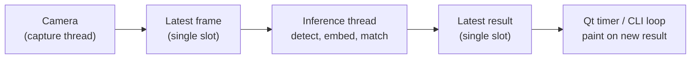

# Technical reference

The long version: architecture, matching maths, storage, tuning, and the checks that
guard the program. The README is the short version for getting it running.

Contents

1. Architecture
2. Recognition
3. Enrollment
4. Storage
5. Presentation check (photo versus real face)
6. Performance
7. Configuration
8. The model
9. Project structure
10. Troubleshooting
11. Development
12. Threat model summary

---

## 1. Architecture

### 1.1 The realtime pipeline

Three components run independently, so one slow frame can never freeze the window:



- The capture thread reads frames continuously and keeps **only the newest one**.
  Frames that arrive while inference is busy are dropped on purpose: showing a stale
  box is worse than skipping a frame.
- The inference thread waits on the handoff slot's own version counter, never on the
  frame number. The camera skips numbers when a new frame lands while nobody is
  reading, so comparing those numbers parks the thread behind the camera and the
  preview drops to a few frames per second.
- The inference thread owns the model and is the only thread that touches ONNX Runtime,
  so no locking is needed around the session. It also feeds the presentation check and,
  on a confirmed match, the attendance service.
- The interface polls every 8 ms. It paints the newest captured frame on every poll and
  takes the readout text from the inference result, so a slow detection cannot make the
  video stutter.
- Boxes and names are painted by the video widget in widget coordinates, scaled from the
  frame pixels of the last result. Nothing is drawn into the frame buffer, so the picture
  stays a zero-copy view of the camera array. A box is drawn for every face, which
  matters when two people are in shot, and the label sits above the box, folding inside
  it when the face is at the top edge.
- Labels are only rewritten when their text or tone actually changes, and the
  statistics row refreshes four times per second instead of once per frame. At 20 to 30
  results per second, restyling a widget per result is visible as flicker.

### 1.2 Frame budgets

Two settings keep the CPU cost down without hurting accuracy:

| Setting | Meaning |
| --- | --- |
| `recognition.detection_interval` | Detect on every Nth frame, reuse the boxes in between |
| `recognition.embedding_interval_seconds` | Re-embed each tracked face at most this often |

A face is tracked between detections by box overlap (IoU), so its name and box stay
stable while the detector rests. Tracks expire after `recognition.track_max_age_seconds`;
there is no long-term person tracking.

### 1.3 Locking rules

- Qt widgets never hold a lock while painting.
- A `QImage` built from a NumPy buffer is copied unless the caller keeps the reference.
  The live view keeps it, to avoid a copy per frame.
- The database opens one SQLite connection per thread (section 4.2).

---

## 2. Recognition

### 2.1 How a match is decided

1. The face is cropped and aligned with the ArcFace 5-point template.
2. The recogniser returns a 512-dimensional embedding, L2-normalised.
3. Cosine similarity is computed against **every stored sample** of every active
   identity. An identity is scored by its *best* sample, never by an average, so one bad
   angle cannot drag a correct identity below the threshold.
4. The best identity is accepted when three conditions hold:
   - similarity is at least `recognition.similarity_threshold`;
   - if `recognition.ambiguity_margin` is above 0, the runner-up is at least that far
     behind;
   - the same identity wins `recognition.confirmation_hits` consecutive checks.
5. Only then does the name appear, and only then can attendance be recorded.

Until the confirmation count is reached the face is labelled *Verifying*, not named.

### 2.2 The percentage is not a probability

Similarity is a cosine distance in [-1, 1]; the interface multiplies it by 100 for
readability and clamps at 0. A 62% match does not mean "62% likely to be the same
person". It means the two embeddings are 0.62 similar. Calibrate the threshold on your
own camera and lighting; the 0.45 default is a starting point for `buffalo_s`.

---

## 3. Enrollment

### 3.1 The five stages

One "look at the camera" capture produces five nearly identical samples, which is close
to useless: recognition degrades the moment the head turns. So the capture is a fixed
sequence, and each sample must satisfy its own pose:

| Stage | Requirement |
| --- | --- |
| 1. Front | `abs(yaw)` at most `registration.frontal_yaw_tolerance` |
| 2. Turn left | yaw at most minus `registration.turned_yaw` |
| 3. Turn right | yaw at least plus `registration.turned_yaw` |
| 4. Tilt | `abs(roll)` inside `tilt_roll_min_deg` to `tilt_roll_max_deg` |
| 5. Closer | face at least `closer_scale_ratio` times the size of the first sample |

Every stage also enforces `registration.stage_max_roll_deg`, so a random head tumble
never passes as a turn.

### 3.2 Quality gate

Before a frame is considered for the current stage it must clear all of these:

- exactly one face in frame;
- face at least `quality.min_face_size_px` across;
- detector confidence at least `quality.min_det_score`;
- sharpness (Laplacian variance) at least `quality.blur_threshold`;
- brightness within `brightness_min` to `brightness_max`, contrast at least
  `contrast_min`;
- no extreme yaw or roll (`max_yaw_ratio`, `max_roll_deg`).

The prompt on screen names the first failed check, so the person knows what to fix.

### 3.3 Guards around the stored identity

1. **Consistency**: a new sample must be at least
   `registration.min_sample_consistency` similar to the samples already collected, so a
   different person walking past mid-capture cannot join the set.
2. **Duplicate guard**: a face that already matches another identity above
   `registration.duplicate_similarity_threshold` is refused, and you are pointed at
   "re-record" instead of creating a twin.
3. **Model identity**: the embedding dimension and the model signature
   (`buffalo_s:w600k_mbf`) are stored with the first identity. A later run with a
   different pack is refused, because two packs can both produce 512 numbers that are
   not comparable.
4. **Name required**: the name is written to the database together with the samples, and
   it is what attendance shows, so saving is blocked until it is filled in.

---

## 4. Storage

### 4.1 Schema

```
employees(id, employee_id, full_name BLOB encrypted, created_at, updated_at, active)
face_embeddings(employee_pk -> employees.id, embedding BLOB encrypted,
                embedding_dim, det_score, quality_score, yaw_ratio, roll_deg, created_at)
attendance(id, employee_pk, work_date, first_seen, last_seen, sightings, status, source,
           UNIQUE(employee_pk, work_date))
audit_log(id, at, action, detail)
schema_meta(key, value)   -- schema_version, embedding_dimension, model_signature,
                          -- employee_id_sequence, encryption
```

Embeddings are stored as raw float32, then encrypted, so values read back are exactly
the values written while the file on disk stays unreadable (section 4.3).

IDs are generated (`001`, `002`, ...) and **never reused**, even after a delete: an
attendance record must not be attributed to a different person later. Identities are
deactivated rather than deleted by default, so history survives a person leaving.

### 4.2 One connection per thread

The GUI thread, the enrollment worker, and the inference thread that records attendance
all touch the same file, and a `sqlite3` connection may only be used by the thread that
opened it. `FaceDatabase` therefore keeps one connection per thread, all pointing at the
same file. WAL mode plus the busy timeout let those connections share it safely, and
`close()` shuts down every connection, including the ones opened by threads that have
already finished.

### 4.3 Encryption

The values that identify a person are encrypted before they are written:

| Stored value | Protection |
| --- | --- |
| Full name | AES-GCM, bound to the employee ID |
| Face embeddings | AES-GCM, bound to the employee ID |
| Employee ID, timestamps, scores, attendance dates | readable, so the app can query and sort |

The key is 32 random bytes in `database/face_key.bin`, restricted to the owner: mode
`0600` on POSIX, and on Windows an ACL built with the shipped `icacls` that drops
inherited entries and grants the current account alone. Without that second step the
key inherited `Authenticated Users: Modify` from its folder, which let any other
account on the machine copy the key and decrypt every face. A value is bound to its
place with associated data (`employees:001:full_name`), so a ciphertext copied into
another row fails to decrypt instead of silently moving a name to a different person.

With a passphrase supplied (`FACEID_PASSPHRASE` or `--passphrase`) the key file holds
the key wrapped with AES-GCM under a scrypt-derived key, and copying the file is no
longer enough. To wrap an existing key or rotate the passphrase:

```bash
# Linux / macOS
export FACEID_PASSPHRASE='something only you know'
# Windows PowerShell
$env:FACEID_PASSPHRASE = 'something only you know'

python main.py status                       # picks the variable up automatically
python main.py --passphrase 'secret' status

python -c "from pathlib import Path; from src.crypto import rotate_key; \
rotate_key(Path('database/face_key.bin'), 'new', 'old')"
```

An existing plain-text database is encrypted on the first start with encryption on, and
the file is compacted afterwards (`VACUUM`) so the old readable pages do not remain in
the file or in the write-ahead log.

### 4.4 Attendance rules

A confirmed match marks the person present for that calendar day:

- **Once per day.** `UNIQUE(employee_pk, work_date)` in the database is the guarantee,
  not application logic. A second sighting updates `last_seen` and a counter instead of
  adding a row, at most every `attendance.refresh_seconds`.
- **Present or late.** The first sighting is `late` when it falls after
  `attendance.work_start` plus `attendance.late_after_minutes`, otherwise `present`.
- **Only for a real face.** With `attendance.require_live_face` on, a face the
  presentation check flagged as a photo or screen is not recorded.
- **Corrections are logged.** Deleting a row, renaming or deactivating a person all
  append to the local `audit_log`, readable with `python main.py audit`.

The clock is the workstation clock. There is no network time server and no signed time
source, so if the machine clock is wrong, the attendance is wrong. That is a deliberate
trade for a local, offline system, and it is why the audit trail records when each change
was made. The daily list is one indexed query per refresh, and a sighting costs a write
only when a row is created or the refresh interval has passed.

### 4.5 Backup and recovery

| Task | Command |
| --- | --- |
| Consistent copy of the database | `python main.py backup` |
| Copy the key | manual: copy `database/face_key.bin` somewhere safe |
| Restore | stop the app, put the `.db` file back as `database/face_database.db`, put the key back |
| Monthly attendance for HR | Attendance page, **Export this month** |

`backup` uses SQLite's own backup API, so the copy is consistent even while the app is
running, and it includes everything still in the write-ahead log.

There is no automatic off-site copy. Copy `database/backups/` and the key file to another
machine or a USB stick on a schedule you can keep. Backups are only useful together with
the key that was in force when they were taken.

---

## 5. Presentation check (photo versus real face)

### 5.1 The geometry

A face on a printed photo or on a phone screen is a flat surface. A real face is not: the
nose stands out of the plane through the eyes and mouth. When the head moves, a flat
surface can be described by one homography with no residual, while a real face leaves a
residual concentrated at the nose.

The check measures exactly that, per face and over time:

1. keep the five landmarks of the last frames, dropping anything older than
   `liveness.observation_window_seconds`;
2. for every usable pair of frames with enough head movement, fit a homography from
   the earlier landmarks to the later ones, **using only the four landmarks that are
   coplanar by construction** (both eyes, both mouth corners);
3. measure how far the nose lands from where that plane predicts it, relative to the
   eye distance. The fit is exact on the four points it uses, so none of the depth is
   absorbed into it and the nose residual is the whole signal.

### 5.2 Why the label does not flicker

A single frame pair is noisy, and a label that changes every second is worse than no
label. Three mechanisms keep the published answer steady, and they are why the label
now changes once or twice per session instead of several times per second:

| Mechanism | Setting | What it prevents |
| --- | --- | --- |
| Decisions run on a timer, not per frame | `liveness.decision_interval_seconds` (1.5 s) | Recomputing from one or two new frames |
| The decision uses the **median over every pair** in the window | `liveness.observation_window_seconds` (3 s) | One lucky or unlucky pair deciding the answer |
| A new level must repeat before it is published | `liveness.stability_windows` (2) | A single doubtful window flipping the label |

Landmarks are still collected on every frame, so a shorter interval only makes the
first answer arrive sooner. When the evidence sits between the two thresholds, the
label stays *Not verified* rather than guessing, because a wrong "photo" accusation is
worse than an honest "cannot tell".

The guard is also reset whenever the person being watched changes, or when a second
person walks into frame, so one face's landmarks can never become another's evidence.

### 5.3 Verdicts and modes

| Label | Meaning |
| --- | --- |
| **Real face (3D)** | The nose moved further than the flat plane allows, so the face has depth |
| **Photo or screen (2D)** | The face moved like a flat surface, so it is a print or a display |
| **Not verified** | Not enough movement yet, no face in view, or two faces at once |

`liveness.mode` decides what the verdict is allowed to do: `off` measures nothing,
`advisory` shows the label and still reports the match, `enforce` refuses to name a face
detected as a photo. Enrollment refuses a suspected photo in every mode except `off`,
because a spoofed sample would stay in the database for as long as that identity exists.
Attendance does the same while `attendance.require_live_face` is on.

The check needs one face at a time, because it compares a face with itself over time.
With two people in view the label stays *Not verified*.

### 5.4 What it catches and what it cannot

Catches: a printed photo, or a still image on a screen, moved or turned in the hand.

Does not catch: a video replay of a real person on a screen (its parallax is genuine), a
bent or curved print, a 3D mask, or a perfectly still attack (no movement means no
evidence, so the label stays *Not verified*). This is a measurement, not a certified
presentation-attack detector.

---

## 6. Performance

### 6.1 Hardware tiers

`performance.profile` selects a tier: `auto`, `minimal`, `low`, `balanced`, or `high`.
`auto` reads the CPU core count and installed RAM, and detects single-board computers
from the device-tree board name and the CPU architecture.

| Tier | Detector | Inference threads | Detect every | Embed every | Camera FPS |
| --- | --- | --- | --- | --- | --- |
| minimal | 256x256 | 1 | 5th frame | 1.5 s | 15 |
| low | 320x320 | 1 | 3rd frame | 1.0 s | 30 |
| balanced | 320x320 | 2 | 2nd frame | 0.5 s | 60 |
| high | 480x480 | 4 | every frame | 0.4 s | 60 |

A tier changes performance settings only. Thresholds, sample counts, and quality limits
are never touched, so switching tier cannot silently change recognition behaviour.

Nothing in the app caps the frame rate. The camera is asked for 15 to 60 frames per
second depending on the tier, the display paints whenever a new frame exists, and the
interface never waits for inference. What the tier throttles is the expensive work
(detection and embedding), which keeps a 1 GB board responsive at the same camera
resolution as a laptop. OpenCV is pinned to a single thread so it does not fight the
inference threads for the same two or four cores.

### 6.2 GPU acceleration

The models run through ONNX Runtime, so the GPU is used when the installed `onnxruntime`
build can reach it. `model.providers` decides, and `auto` (the default) takes the fastest
backend that build provides:

| Value | Backend | Install |
| --- | --- | --- |
| `auto` | first of the list below that exists | nothing |
| `directml` | any DirectX 12 GPU: AMD, Intel, or NVIDIA | `pip install onnxruntime-directml` |
| `cuda` | NVIDIA with a matching CUDA runtime | `pip install onnxruntime-gpu` |
| `openvino` | Intel graphics and CPUs | `pip install onnxruntime-openvino` |
| `cpu` | always available | nothing |

`requirements.txt` installs the DirectML build on Windows, so an AMD or Intel integrated
GPU is used out of the box; other platforms keep the CPU build. Replace that line with
`onnxruntime-gpu` for an NVIDIA card. Only one of those builds may be installed at a
time: uninstall the old one first, because they all install the same package directory.

DirectML needs `enable_mem_pattern = false` and sequential execution, which the loader
sets automatically, and it allows one inference at a time per session. The app already
runs one inference thread, so nothing else changes. If a GPU session cannot be created (a
missing driver, an unsupported operator, too little video memory), the loader logs the
reason and rebuilds on the CPU instead of leaving the app without a model.

Small models do not automatically get faster. Measured on a Ryzen 3 4300U with Vega 8
(median per frame, one face):

| Detector size | CPU | DirectML on Vega 8 |
| --- | --- | --- |
| 320x320 | 16.0 ms | 16.9 ms |
| 480x480 | 23.1 ms | 22.1 ms |

The GPU is even at 320 and ahead at 480, and it takes the inference load off the four CPU
cores that also decode the camera and paint the window. On a discrete GPU the difference
is much larger. Measure on the machine that will run the app before pinning a provider:

```bash
python main.py providers                      # compare every backend on this machine
python main.py providers --det-size 480       # the same at a larger detector input
python main.py providers --provider DmlExecutionProvider --frames 30
```

The Overview page shows the backend in use (`DirectML (GPU)`, `CPU`, ...), and
`python main.py status` prints it next to the hardware line.

### 6.3 Measuring and tuning

```bash
python main.py benchmark
```

This runs the real pipeline for `benchmark.duration_seconds` and writes
`benchmarks/benchmark-<timestamp>.json` with per-second capture FPS, inference FPS, frame
time (mean and p95), dropped frames, process CPU, process RAM, and faces per frame. A
short table is printed and compared with `benchmark.target_display_fps`.

Record the numbers on your own machine instead of trusting a table. If inference FPS sits
below your target, in this order:

1. set `performance.profile` to `minimal`;
2. raise `recognition.embedding_interval_seconds` to 1.5;
3. raise `recognition.detection_interval` to 5;
4. lower `camera.requested_fps` to 15 (less capture work, same accuracy);
5. only then consider a smaller camera resolution.

A webcam often delivers fewer frames than requested, especially in dim light, where it
lengthens the exposure. On the reference laptop the same camera returned about 14 to 20
frames per second at 320x240, 424x240, 640x480, 800x600, and 1280x720, so resolution
changed nothing: the device, not the app, set the ceiling.

---

## 7. Configuration

### 7.1 Precedence

Highest first:

1. `settings.json`: what you changed on the Settings page (sparse overrides);
2. the active performance tier;
3. `config.yaml`: the shipped baseline, with comments.

All three are merged and re-validated through one code path, so a hand-edited file cannot
introduce a value the normal loader would reject. Unknown keys are a hard error: a typo
fails at startup instead of being silently ignored. Delete `settings.json` to return to
the defaults.

Settings that need the model or the camera to be rebuilt (camera index, resolution,
backend, detector size, thread count) are marked in the app and take effect on the next
start. A provider change reloads the model immediately.

### 7.2 Settings reference

The Settings page exposes these; the same keys work in `settings.json`.

| Key | Default | Why you would change it |
| --- | --- | --- |
| `recognition.similarity_threshold` | 0.45 | Raise if look-alikes match, lower if you are rejected |
| `recognition.ambiguity_margin` | 0.0 | Reject close calls between two similar people |
| `recognition.confirmation_hits` | 3 | How many agreeing frames before a name appears |
| `recognition.max_faces` | 5 | Faces processed per frame |
| `recognition.detection_interval` | 2 | Detect on every Nth frame |
| `recognition.embedding_interval_seconds` | 0.5 | Re-embed a tracked face at most this often |
| `recognition.track_max_age_seconds` | 2.0 | How long a track survives without a detection |
| `registration.samples` | 5 | Poses captured per identity (1 to 5) |
| `registration.capture_interval_seconds` | 0.4 | Minimum time between accepted samples |
| `registration.min_sample_consistency` | 0.50 | Reject a sample that does not fit the set |
| `registration.duplicate_similarity_threshold` | 0.60 | Refuse a face that already exists |
| `quality.min_face_size_px` | 120 | Small faces give unreliable embeddings |
| `quality.min_det_score` | 0.65 | Detector confidence floor |
| `quality.blur_threshold` | 60.0 | Laplacian variance floor; raise it for a sharp camera |
| `quality.brightness_min` / `max` | 60 / 200 | Reject dark or blown-out frames |
| `liveness.mode` | advisory | `off`, `advisory` (label only), `enforce` (refuse a detected photo) |
| `liveness.min_observations` | 8 | Frames of movement before a verdict is offered |
| `liveness.sensitivity` | 0.5 | Higher reacts to smaller head movements |
| `liveness.decision_interval_seconds` | 1.5 | How often the verdict is recomputed; lower reacts sooner and flickers more |
| `liveness.stability_windows` | 2 | Agreeing decisions needed before the label changes |
| `liveness.observation_window_seconds` | 3.0 | Landmarks older than this stop counting as evidence |
| `database.encrypt` | true | AES-GCM for names and embeddings |
| `database.key_file` | database/face_key.bin | Where the key lives. Back it up separately |
| `attendance.enabled` | true | Mark presence on a confirmed match |
| `attendance.work_start` | 08:00 | Local start time, 24 hour clock |
| `attendance.late_after_minutes` | 15 | Grace period before a first sighting counts as late |
| `attendance.refresh_seconds` | 60 | How often a still-visible face updates `last_seen` |
| `attendance.require_live_face` | true | Do not clock in a face flagged as a photo |
| `camera.index` | 0 | Second webcam |
| `camera.width` / `height` | 640 / 480 | Higher resolution costs inference time, not accuracy |
| `camera.backend` | auto | `dshow`, `msmf` (Windows), `v4l2` (Linux) |
| `camera.requested_fps` | 60 | What the app asks the camera for; the tier overrides it |
| `model.det_size` | 320x320 | Bigger finds smaller faces, much slower |
| `model.intra_op_threads` | 2 | Keep at or below the physical core count |
| `model.providers` | `[auto]` | `auto`, `directml`, `cuda`, `openvino`, `cpu`, or a provider name |
| `ui.style` | dark | `dark` (neutral grey, amber accent) or `light` |
| `ui.animations` | true | Turn off on very slow machines |
| `ui.display_max_width` | 720 | Downscale the preview for a slow screen |
| `performance.profile` | auto | Force `minimal`, `low`, `balanced`, or `high` |

---

## 8. The model

`buffalo_s` from the InsightFace model zoo:

| Part | File | Purpose |
| --- | --- | --- |
| Detection | `det_500m.onnx` | SCRFD face detector (boxes and 5 landmarks) |
| Recognition | `w600k_mbf.onnx` | ArcFace with a MobileFaceNet backbone, 512-dim |

- Downloaded on first use into `models/buffalo_s/` (about 330 MB, resumable).
- Embeddings from different packs are **not** comparable. Changing `model.name` needs a
  new database or re-recording every identity; the app refuses the mismatch instead of
  silently producing wrong matches.
- `buffalo_l` (det_10g + w600k_r50) is more accurate and much heavier on a CPU. To use
  it, change `model.name`, delete the database, and register again.
- The weights carry their own licence (InsightFace model zoo terms; the public packs are
  for non-commercial research). Review it before commercial deployment; this repository
  ships code, not weights.

Alignment uses the standard ArcFace 5-point template (`norm_crop`) at both registration
and recognition. That is what makes the two embeddings comparable.

---

## 9. Project structure

```
main.py                 CLI entry point and commands
install.py              one-shot setup (venv, dependencies, key, model, self-check)
config.py               configuration schema, validation, loading
config.yaml             documented baseline values
src/
  application.py        composition root: config, key, database, model, sessions
  settings.py           settings.json read/write and merge precedence
  performance.py        hardware tiers and profile application
  hardware.py           CPU, RAM, and board detection
  pipeline.py           capture thread, inference thread, latest-result slots
  camera.py             webcam capture thread, backend selection, probing
  face_detector.py      InsightFace wrapper, model download, stage timings
  execution_providers.py  which ONNX Runtime backend to use (GPU or CPU)
  quality.py            blur, brightness, contrast, pose estimation
  enrollment_plan.py    the five poses and their accept/reject rules
  face_registration.py  staged session and persistence with duplicate guards
  face_recognizer.py    tracking, throttling, confirmation, matching, attendance hook
  similarity.py         cosine maths, gallery index, match decision
  presentation.py       real 3D face versus a photo or a screen (parallax test)
  liveness.py           the detector contract and the presentation verdict
  crypto.py             AES-GCM field encryption and key handling
  permissions.py        owner-only files: POSIX modes and a Windows ACL
  database.py           SQLite: identities, embeddings, attendance, audit, backup
  attendance.py         daily presence rules and CSV export
  guidance.py           user-facing instructions during enrollment
  metrics.py            rate and latency counters
  sysmetrics.py         process and machine CPU/RAM sampling
  ui.py                 OpenCV overlays for the headless preview
  benchmark.py          measured performance report, provider comparison
  gui/                  Qt interface: theme, widgets, pages, main window
tests/                  unit tests, with doubles for the model and the camera
```

Files that are created at runtime and never committed: `config.yaml` stays, while
`settings.json`, `database/`, `models/`, `attendance/`, `benchmarks/`, and `.venv/` are
ignored by git.

---

## 10. Troubleshooting

| Symptom | Cause and fix |
| --- | --- |
| `Camera index 0 could not be opened` | In use by another app, blocked by OS privacy settings, or a different index. Run `python main.py status` |
| `onnxruntime is not usable` | Reinstall inside the venv: `pip install --force-reinstall onnxruntime` |
| `Model download failed` | Network or proxy. Re-run `install.py`; the partial file resumes |
| `This database holds embeddings from 'X'` | You changed `model.name`. Restore the old pack, or start a fresh database |
| `is encrypted, but no key was supplied` | Put `database/face_key.bin` back, or set `FACEID_PASSPHRASE` |
| `Wrong passphrase for this database key` | The key file is wrapped with a passphrase you did not match |
| `database/face_key.bin` is missing | Restore it from your backup. Without it the faces cannot be decrypted |
| `face too small` during enrollment | Move closer, or lower `quality.min_face_size_px` |
| Nothing is recognised | Threshold too high, too few samples, or uneven light; run `recognize` and watch the similarity |
| Attendance shows nothing | `attendance.enabled` is off, the clock is before `work_start`, nobody was confirmed, or the face was flagged as a photo |
| Attendance recorded for the wrong day | The machine clock or its timezone is wrong. Fix the clock, then delete and re-mark the row |
| UI is slow but inference is fine | Turn off `ui.animations`, lower `ui.display_max_width` |
| Video looks choppy | The camera sets the ceiling. Check the reported FPS, usually the hardware rate in dim light |

---

## 11. Development

### 11.1 Checks

```bash
python -m unittest discover                                  # 437 tests, no camera or model needed
uv tool run ruff check . --exclude .venv                     # lint
uv tool run pyright                                          # types
uv tool run vulture main.py config.py src tests              # dead code
```

Tests use doubles (`tests/support.py`) for the detector, the camera, and the quality
assessor, so the suite runs offline in under a minute. The presentation check is tested
by projecting a five-point face model through a pinhole camera, once flat and once with a
nose, so the geometry is verified rather than assumed. The GUI tests run on the offscreen
Qt platform and assert behaviour rather than pixels.

### 11.2 House rules

- the inference thread is the only place that touches the model;
- Qt widgets never hold a lock while painting;
- a `QImage` built from a NumPy buffer is copied unless the caller keeps the reference
  (the live view keeps it, to avoid a copy per frame);
- every colour comes from `src/gui/theme.py`; widgets never hard-code one;
- `with sqlite3.connect(...)` does not close the connection: always close it;
- a value that identifies a person is encrypted in `src/database.py`, never at a call
  site;
- per result UI updates must be idempotent: only touch a widget when its content or tone
  changes;
- no em dash anywhere in the repository, which a test enforces.

---

## 12. Threat model summary

What the encryption protects: someone who copies the SQLite file, or a backup of it,
cannot read names or embeddings without the key. Other accounts on the same machine
cannot read the key either, because it is owner-only on both platforms (section 4.3).

What it does not protect: an attacker who is already running code as your user on the
machine, because the app needs the key open to work. SQLite itself is not encrypted, so
the structure (how many identities exist, when they were added) stays visible.

There is no telemetry, no upload, and no network access after the model is on disk. You
can verify that by running the app with networking disabled.
